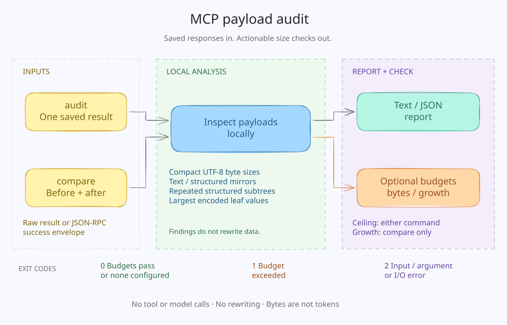

# mcp-payload-audit

[](https://github.com/SiluPanda/mcp-payload-audit/actions/workflows/ci.yml)

**Find what makes an MCP tool result large—before it surprises your users.**

A small, offline Python CLI for saved `tools/call` responses. It reports response
bytes, JSON mirrored into text, repeated structured subtrees, and the largest
fields. Put a byte ceiling or a fixture-growth check in CI.

- **No runtime dependencies, API keys, network calls, or tool execution.**
- Reads fixtures; never rewrites responses or removes compatibility fallbacks.
- Human-readable and versioned JSON reports; useful exit codes for CI.
- Python 3.11+. MIT licensed. Early-stage `0.1.0`.

## How it works



[Editable Excalidraw source](docs/assets/workflow.excalidraw)

## Quick start

```sh
git clone https://github.com/SiluPanda/mcp-payload-audit.git
cd mcp-payload-audit
python -m pip install .

mcp-payload-audit audit examples/mirrored.json
mcp-payload-audit audit examples/mirrored.json --format json
mcp-payload-audit compare examples/lean.json examples/mirrored.json --max-growth-percent 10
# The comparison above intentionally exits 1: the candidate is larger.
```

Or run from a checkout without installing anything:

```sh
PYTHONPATH=src python -m mcp_payload_audit audit examples/mirrored.json
```

This project is available on GitHub; **it is not published to PyPI**.

## What it finds

Given a result with the same data in `structuredContent`, a text block, and
multiple nested fields, the report shows:

1. Compact UTF-8 result bytes, distinct from original file size.
2. Exact whole-JSON text/structured mirrors, even if object key order differs.
3. Repeated nonempty objects/arrays within `structuredContent` (64-byte minimum
   by default), including duplicated rows and evidence envelopes.
4. Largest encoded leaf values, identified by JSON Pointer rather than contents.

For the included synthetic `examples/mirrored.json`:

```text
Compact result: 4,879 bytes
Text/structured mirrors: 1 (informational)
Repeated structured subtrees: 3
  2 occurrences x 907 value bytes:
    /structuredContent/evidence/normalized_result
    /structuredContent/rows
Largest encoded leaf: /content/0/text — 2,922 bytes
```

This is an abbreviated report, not a benchmark or a token-savings claim.

Findings are **informational**. A duplicate is not automatically a bug. MCP
[recommends a text fallback for structured output](https://modelcontextprotocol.io/specification/2026-07-28/server/tools#structured-content),
and clients differ in what they expose to a model. Never remove fallback content
without testing your clients.

## CI budgets

```sh
# Absolute budget, per compact result, not source file formatting.
mcp-payload-audit audit tests/fixtures/search-result.json --max-bytes 65536

# Compare the same representative workload before and after a change.
mcp-payload-audit compare baseline.json candidate.json \
  --max-growth-percent 10 --max-bytes 65536 --format json

# Read one saved result from stdin.
cat examples/lean.json | mcp-payload-audit audit - --max-bytes 65536
```

The tool does not create baselines or invoke your server. Capture representative
responses using your existing tests, sanitize them, and review fixture updates.
Do not compare unrelated workloads or refresh the baseline blindly.

| Exit | Meaning |
| --- | --- |
| `0` | Analysis completed; all configured budgets passed (or none configured) |
| `1` | Absolute size or growth budget exceeded |
| `2` | Invalid/unsupported input, read error, or invalid CLI arguments |

Equality passes: a 65,536-byte result satisfies `--max-bytes 65536`. Both budgets
apply to the **candidate** in `compare`. Tool `isError: true` is reported but does
not itself fail a size budget; use your functional tests to assert tool success.

## Python API

```python
from mcp_payload_audit import analyze_result, loads_document

result = loads_document('{"content": [{"type": "text", "text": "hello"}]}')
report = analyze_result(result)
assert report["compact_result_bytes"] <= 65536
```

`analyze_result` does not mutate its input. Use `loads_document` rather than
plain `json.loads` to reject ambiguous duplicate object keys and nonfinite numbers.
See [measurement and input contract](docs/measurement.md).

## Limits and privacy

- Accepts one UTF-8 JSON `CallToolResult` or successful JSON-RPC 2.0 response.
  No JSONL, batches, traces, SDK session logs, or `tools/list` schemas in v0.1.
- Supports object/array/scalar/null `structuredContent` from MCP 2026-07-28;
  accepts older complete-result shapes too. This is not a full MCP validator.
- **Bytes are not tokens, context occupancy, provider charges, or promised savings.**
  JSON-RPC framing, HTTP compression, client projection, and prompt caching differ.
- `_meta`, base64 media, and unknown fields count toward serialized result size.
  That does not mean the model receives them. No media decoding or remote fetching.
- CLI inputs are limited to 16 MiB; JSON nesting to 64 levels and 200,000 values.
  Expanded JSON pointers have an additional 8 Mi-character work budget.
- Exact matching is after Python JSON parsing; decimal numbers can round or
  underflow to the same float. It is not arbitrary-precision numeric comparison.
- Reports omit payload values, but paths and property names can themselves be
  sensitive. This is **not a redaction tool**. Treat reports and fixtures as private
  until reviewed. `captures/` is gitignored for local experiments.
- No automatic compression, semantic deduplication, pagination, or repair.

## Development

With [uv](https://docs.astral.sh/uv/):

```sh
uv sync --locked --group dev
uv run ruff check .
uv run ruff format --check .
uv run pytest --cov=mcp_payload_audit
uv build
```

See [CONTRIBUTING.md](CONTRIBUTING.md) and [SECURITY.md](SECURITY.md).
